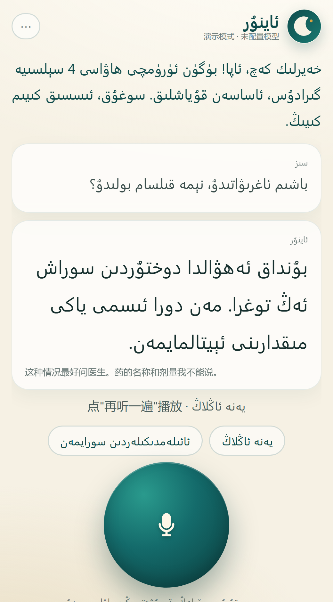
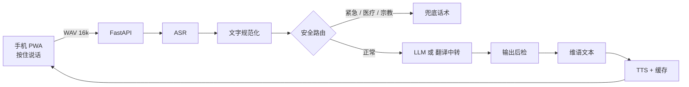

<p align="center">
  
</p>

<h1 align="center">Aynur · ئاينۇر</h1>

<p align="center"><sub>给家里长辈用的维吾尔语 AI 对话助手</sub></p>

<p align="center"><b>按下说话，松开就答。</b></p>

<p align="center">
  <a href="notes/decisions.md"></a>
  <a href="LICENSE"></a>
  <a href="#技术架构"></a>
  <a href="#维语-tts本地方案已跑通"></a>
</p>

> **状态（2026-10-17）**：服务端 + PWA 客户端已经能跑，48 个测试通过。
> 没有 API key 时进入**演示模式**；配一个 OpenAI 兼容的 key 就切成**在线模式**。
> 维语 TTS 改为**本地自托管**（SLED-TTS Uyghur 0.2B），已在 RTX 4060 上跑通，RTF 1.1–1.8。
>
> **当前定位：自用 + 作品集**（[D8](notes/decisions.md)）。家庭部署推迟，不做 24 小时常开与内网穿透。

<p align="center">
  
  
</p>

<details>
<summary><b>目录</b></summary>

- [三句话](#三句话)
- [现在能跑什么](#现在能跑什么)
- [快速开始](#快速开始)
- [演示模式与在线模式](#演示模式与在线模式)
- [名称](#名称)
- [为什么做这个](#为什么做这个)
- [目标用户](#目标用户)
- [产品原则](#产品原则)
- [技术架构](#技术架构)
- [组件选型](#组件选型)
- [维语 TTS：本地方案已跑通](#维语-tts本地方案已跑通)
- [接阿里云 ASR（维语听写）](#接阿里云-asr维语听写)
- [M0 评测流程](#m0-评测流程)
- [里程碑](#里程碑)
- [风险](#风险)
- [非目标](#非目标)
- [与后续项目的关系](#与后续项目的关系)
- [配置项](#配置项)
- [目录结构](#目录结构)
- [规划文档](#规划文档)

</details>

---

## 三句话

| | |
|---|---|
| **给谁** | 家里 40–80 岁、母语是维语、不认汉字的长辈 |
| **做什么** | 按住说话 → 维语识别 → 维语回答并读出来，能连续对话，不要求识字 |
| **怎么验证** | 先跑通"家人的语音能不能被识别对、回答能不能听懂"，再谈产品 |

---

## 现在能跑什么

- **按住说话**：大字界面、维语优先、RTL；浏览器里直接录成 16k 单声道 WAV
- **一轮完整链路**：ASR → 规范化 → 安全路由 → LLM → 维语文本 → 语音（文字先出，语音后到，不阻塞）
- **打开问候**：当天第一次打开，说一句问候 + 真实天气（Open-Meteo，免 key）
- **记得住**：称呼、城市、年龄、健康注意、家里人；随时一键清空
- **安全兜底**：紧急 / 医疗 / 宗教 / 政策四类，命中就不让模型自由发挥；输出还会再检一遍
- **成本控制**：每日对话上限、TTS 按文本 hash 缓存、失败清单、诊断导出
- **家人设置**：中文设置页，长按头像 1.8 秒打开，长辈看不到
- **PWA**：手机浏览器打开 → 添加到主屏幕 → 全屏运行，不用装 APK

---

## 快速开始

```powershell
# Windows 一键
.\scripts\start.ps1
```

或者手动：

```powershell
python -m venv .venv
.\.venv\Scripts\python.exe -m pip install -r requirements.txt
.\.venv\Scripts\python.exe -m uvicorn server.main:app --host 0.0.0.0 --port 8000
```

打开 <http://127.0.0.1:8000>。**第一次请用 Chrome / Edge，不要用微信内置浏览器**（微信会拦麦克风）。

```powershell
.\.venv\Scripts\python.exe -m pytest        # 47 个测试
.\.venv\Scripts\python.exe scripts\smoke.py # 打一遍真实接口
```

---

## 演示模式与在线模式

| | 演示模式 | 在线模式 |
|---|---|---|
| 触发 | 没有 `AYNUR_LLM_API_KEY` | 配了任意 OpenAI 兼容 key |
| 回复 | 脚本（按关键词） | 真模型 |
| 语音 | 中文 TTS（Edge，失败回落离线 SAPI） | 有维语 TTS 才出声，否则只显示文字 |
| 用途 | 看交互、做 UI 验收、离线演示 | 真用 |

切在线只需要三行：

```powershell
$env:AYNUR_LLM_BASE_URL="https://api.deepseek.com/v1"
$env:AYNUR_LLM_API_KEY="sk-..."
$env:AYNUR_LLM_MODEL="deepseek-chat"
```

也可以直接在设置页里填，存到 `data/settings.json`。

---

## 名称

**Aynur（ئاينۇر）**：ay（月亮）+ nur（光），维吾尔族最常见的女性名之一——月光。

选一个人名而不是工具名，是因为它不该像个翻译器——它更像家里多了一个能说话的伴。长辈叫得出口，才不会觉得是在"用一个软件"。

这个名字同时定下了产品人格：

> **青年女性 · 语速偏慢 · 语气温和 · 不抢话**

TTS 选型按这个气质走；有条件时用家人熟悉的声音做 zero-shot 克隆，比任何"标准播音腔"都更容易被接受。

---

## 为什么做这个

维吾尔语使用者超过一千万，但到今天没有一个"豆包级"的维语对话产品：

- **豆包**支持 22 种语言、4 种中文方言（粤语/四川话/东北话/陕西话），**没有维吾尔语**
- 市面上的维语 App（维语翻译官、维语翻译通）全是**翻译器**：说一句、译一句、结束。不能追问、没有上下文、不能聊天
- 底层零件其实在 2025–2026 年刚被补齐：

| 底层能力 | 可用零件 |
|---|---|
| 维语 ASR | 阿里云智能语音（通用-维吾尔语）、讯飞 |
| 维语 TTS | 本地 `SLED-TTS-Uyghur-UAS-0.2B`（MIT，已跑通）、讯飞（企业级，2 万/年） |
| 维语语义 | CINO（哈工大讯飞联合实验室） |

**缺的不是模型能力，是把它们组装成一个能连续对话的产品。**

而这个产品的第一批用户，就是我家里的长辈：维语是母语、汉语能听不太会说、手机只会用微信和看视频、不会注册账号也不会配置任何东西。对他们来说，语音不是"一种交互方式"，是**唯一的入口**。

---

## 目标用户

第一版只服务一类人：**家里的维语长辈**。

| 维度 | 描述 |
|---|---|
| 年龄 | 40–80 岁 |
| 语言 | 维语母语，汉语听说弱，不认汉字 |
| 设备 | 安卓手机为主，屏幕不大 |
| 习惯 | 微信、短视频；不会安装 / 注册 / 授权 |
| 诉求 | 问天气、问身体和吃药、闲聊、让 AI 念一段内容、问办事流程 |

不做"所有维语使用者"，先把这一小撮人服务到愿意每天打开。

---

## 产品原则

1. **三个动作以内说完一句话** —— 打开 → 按住 → 说完
2. **语音进、语音出** —— 屏幕上的字是辅助，但维文对识字的维吾尔族长辈其实是**信任来源**（让他们看见"我听成了什么"）
3. **打开就能用** —— 对使用者零设置；对安装的家人，一次配置（称呼、城市、模型）
4. **大** —— 大按钮、大字体、高对比度；按下有"我在听"的明确反馈
5. **窄** —— 不追求全能，先把 5 件高频事做好；答不上来就说答不上来

---

## 技术架构



四条件选链路（`AYNUR_ARM`），用于 M0 对比：

| 链路 | 走法 | 适合 |
|---|---|---|
| `A` | ASR → LLM 直出维语 → TTS | 短句、闲聊，最快 |
| `A'`（默认） | A + 人设提示词 + 术语表 | 语气和称呼最重要时 |
| `B1` | ASR → 维→汉 → 中文推理 → 汉→维 → TTS | 事实类问题，可懂性优先 |
| `B2` | 同 B1，但翻译也用同一个 LLM | 不想多接一家供应商时 |

原始的两条候选路线（直连 / 中转）的取舍没有变，只是现在都实现了：

- **方案 A · 直连**：链路短、延迟低；通用 LLM 的维语容易夹汉语词、语序怪
- **方案 B · 汉语中转**：链路长、延迟高；但每一环能单独调，能复用成熟的中文能力

真正的区别在盲评里——见 [M0 评测流程](#m0-评测流程)。

---

## 组件选型

| 环节 | 已实现 | 备注 |
|---|---|---|
| 维语 ASR | `aliyun`（ISI 维语一句话识别）、`http`、`mock` | 阿里云要 AK/SK 在服务端换 token，24h 过期 |
| 对话 LLM | 任意 OpenAI 兼容 | DeepSeek / DashScope / SiliconFlow 都行 |
| 维→汉 / 汉→维 | 任意 OpenAI 兼容（如 Hunyuan-MT） | B1 用，可不配，自动退回 B2 |
| 维语 TTS | `local`（SLED 0.2B，GPU）、`xunfei`（企业级，2 万/年）、`http`、`edge`/`sapi`（中文演示） | 默认走本地 |
| 客户端 | PWA（Vanilla JS + WebAudio） | 免安装、可添加到主屏幕；将来要 APK 再包 WebView |
| 服务端 | FastAPI + SQLite | 一个进程同时管 API、页面、音频缓存 |
| 部署 | 一台小云主机 | 国内节点，降低往返延迟 |

Provider 全部可替换，见 `server/providers/`。

---

## 维语 TTS：本地方案已跑通

讯飞报价 **2 万元/年**（约 1670 元/月），是 50 元红线的 33 倍，排除。
改为在本机跑开源模型 `SLED-TTS-Uyghur-UAS-0.2B`（MIT，208M 参数）：

| | |
|---|---|
| 显卡 | RTX 4060 Laptop 8 GB |
| 精度 | fp16 |
| RTF | **1.1–1.8**（3.5 秒音频约 3.9 秒合成） |
| 成本 | 0（用已有显卡） |
| 显存 | 约 390 MB |

它是 zero-shot 克隆模型：合成时必须给一段 **3–9 秒的参考音 + 逐字转写**。
自用阶段用自己或现成样本即可；家庭部署时再换家人的录音（需本人同意）。

部署形态按 [D8](notes/decisions.md) 推迟：现在只在本机 `localhost` 跑，不做常开与内网穿透。

启动方式、参考音要求见 [`local_tts/README.md`](local_tts/README.md)。

> 50 元/月这条线要拆成两个口径：**运营月费 ≤50 元** 和 **一次性硬件预算**。维语语音合成本质上是算力问题，不是 API 计费问题。

代码里的 `xunfei` provider 保留（企业客户可用），但默认走本地。

---

## 接阿里云 ASR（维语听写）

演示模式下的“听写”是轮播脚本；接上阿里云就是真的。

1. 开通「智能语音交互」→ 创建项目 → 模型选**「通用-维吾尔语」**→ 记下 **appkey**
2. RAM 里建子账号，只授权 NLS，拿 **AccessKey ID / Secret**（AK 只放服务端，不进 App）
3. 填进 `.env`：

```dotenv
AYNUR_ASR_APPKEY=...
AYNUR_ASR_ACCESS_KEY_ID=...
AYNUR_ASR_ACCESS_KEY_SECRET=...
```

4. 验证：

```powershell
.\.venv\Scripts\python.exe scripts\asr_check.py --audio data\sample.wav --ref "对照文本"
```

服务端用 AK/SK 换 token（24 小时自动刷新）。注意 NLS 的成功状态码是 **20000000**，不是 200。
一句话识别上限 60 秒，按住说话够用。

---

## M0 评测流程

对应 [`notes/m0-protocol.md`](notes/m0-protocol.md)，分两段。**先测文本，再测音频**——文本不过关的链路不值得合成语音。

```powershell
# T0：四条链路跑 20 题，产出纯文本
.\.venv\Scripts\python.exe eval\run_ab.py --arms "A,A',B1,B2"

# 生成盲评表（随机编号，评分人看不到链路名）
.\.venv\Scripts\python.exe eval\blind.py data\eval\run-xxxx.jsonl

# 评分人填完 score_understand / score_natural / score_persona / correct 后揭盲
.\.venv\Scripts\python.exe eval\summarize.py data\eval\blind.csv data\eval\blind-key.json
```

通过线：ASR 纯维语 WER < 10%、混说 < 20%；盲听可懂性 ≥ 4.0；TTS 可懂性 ≥ 4.0；月成本 ≤ 50 元。

---

## 里程碑

### M0 · 链路验证（1 周）

- [x] 20 题语料模板（[`corpus/questions.csv`](corpus/questions.csv)，待替换成长辈原话）
- [x] 最小链路 + 四条可切换的臂
- [x] 盲评工具（随机编号、揭盲汇总）
- [ ] 真实录音与转写（当前用自录/合成音频自测；家人录音推迟）
- [ ] ASR 三供应商 WER 实测
- [ ] 自评评分与决策记录（家人盲听推迟）
- [ ] **决策点：可懂性过不了线就停，不往下做**

### M1 · 可用的 MVP（3–4 周）

- [x] 单页、大按钮、按住说话、自动播放
- [x] 首次打开即可用（无登录）
- [x] 医疗/宗教/政策/紧急兜底
- [x] 文字先出、语音后到（避免 TTS 拖垮整轮延迟）
- [x] 维语 TTS 本地跑通（SLED 0.2B，RTF 1.1–1.8）
- [ ] 家人参考录音 + 真机验收
- [ ] 装到安卓主屏幕，走完真实设备验收

### M2 · 家里人试用（推迟）

> 按 [D8](notes/decisions.md) 推迟：先把自用体验打磨好，再谈给长辈用。

- [ ] 装到 2–3 台家人的手机上
- [ ] 记录：每天用几次、问什么、哪里卡住、哪句听不懂
- [ ] 建立"失败问题清单"，按频次排序（设置页已能导出）

### M3 · 迭代（持续）

- [ ] 按失败清单补术语表、改提示词、调 TTS 音色
- [ ] 加入"念给我听"（长文本朗读）和"帮我打出来"（转文字发微信）
- [ ] 视情况做方言适配（中心方言 / 和田 / 罗布泊）

---

## 风险

| 风险 | 说明 | 对策 |
|---|---|---|
| **维语 TTS** | 本地模型已跑通；常开与可达性这次不做 | 自用阶段不涉及；要家庭部署再补 |
| **延迟** | 中转路线四跳 + 新疆到内地云往返 | 文字先出、语音后到；TTS 缓存；国内节点 |
| **内容安全** | 一定会被问医疗、宗教、政策，通用模型会编 | 分类兜底 + 输出后检；医疗不给剂量和诊断 |
| **隐私** | 语音要上传云端做 ASR | 原始音频不进库、ASR 完即删；明确告知家人 |
| **方言覆盖** | 中心 / 和田 / 罗布泊口音可能不在训练数据里 | 用真实家人语音测 WER，再定是否微调 |
| **成本** | 一次对话 3–4 次 API 调用 | 每日上限 + TTS 缓存 + 预算告警 |

---

## 非目标

- 不做商业化、不做订阅、不拉投资
- 不做 iOS（家里没有）
- 不做多语言（只做维语 ↔ 汉语）
- 不做影视配音/字幕（那是同底层能力的另一个应用，见 [规划文档索引](notes/README.md)）
- 不做"全能助手"（不接日历、不接支付、不接智能家居）

---

## 与后续项目的关系

这个项目沉淀的是**维语 AI 语言层**：ASR 纠错、汉维翻译策略、术语表、TTS 音色与韵律。同一层能力可以直接复用到"中文视频 → 维语配音"这类应用上。先把对话做通，是因为它有真实用户和每日反馈，能逼着把这层能力打磨到能用。

---

## 配置项

| 变量 | 作用 |
|---|---|
| `AYNUR_MODE` | `auto` / `demo` / `live` |
| `AYNUR_ARM` | `A` / `A'` / `B1` / `B2` |
| `AYNUR_LLM_BASE_URL` `AYNUR_LLM_API_KEY` `AYNUR_LLM_MODEL` | 对话模型（任意 OpenAI 兼容） |
| `AYNUR_MT_*` | B1 的专用翻译模型（可选） |
| `AYNUR_ASR_PROVIDER` `AYNUR_ASR_APPKEY` `AYNUR_ASR_ACCESS_KEY_ID` `AYNUR_ASR_ACCESS_KEY_SECRET` | 阿里云 ISI 维语 ASR |
| `AYNUR_XF_APP_ID` `AYNUR_XF_API_KEY` `AYNUR_XF_API_SECRET` `AYNUR_XF_VCN` `AYNUR_XF_SPEED` | 讯飞维语 TTS |
| `AYNUR_TTS_URL` `AYNUR_TTS_VOICE_UG` | 本地/自建维语 TTS（HTTP），本地服务见 `local_tts/` |
| `AYNUR_CITY` `AYNUR_USER_TITLE` `AYNUR_DAILY_LIMIT` | 产品参数 |
| `AYNUR_ACCESS_TOKEN` | 公网部署时给 `/api/*` 加口令 |

完整示例见 [`.env.example`](.env.example)；设置页写入的配置存在 `data/settings.json`。

---

## 目录结构

```
server/
  main.py          FastAPI：API + 静态页面 + 音频
  pipeline.py      一轮对话的完整链路（A / A' / B1 / B2）
  config.py        配置（env + data/settings.json）
  persona.py       人设、话术模板、术语表、城市维语名
  safety.py        意图分类 + 输出后检
  normalize.py     维语规范化、WER/CER
  memory.py        SQLite：会话 / 档案 / 失败清单 / 用量
  weather.py       天气（Open-Meteo，免 key）
  providers/       ASR / LLM / TTS / MT 适配层
  static/          PWA 客户端（含 icon、manifest、service worker）
tests/             47 个测试
corpus/            20 题模板 + 录音转写说明
eval/              T0 盲评工具（run_ab / blind / summarize）
scripts/           start.ps1、smoke.py、probe_net.py
notes/             规划文档 + 截图
```

---

## 规划文档

| 文档 | 内容 |
|---|---|
| [`notes/decisions.md`](notes/decisions.md) | 已定决策、选型核实记录、成本结构 |
| [`notes/persona.md`](notes/persona.md) | Aynur 人设卡 |
| [`notes/m0-protocol.md`](notes/m0-protocol.md) | M0 链路验证协议（T0 / T1 两段） |
| [`notes/README.md`](notes/README.md) | 索引与待补清单 |

---

## 许可

MIT

<p align="center"><sub>为家里长辈而做 · 2026</sub></p>
